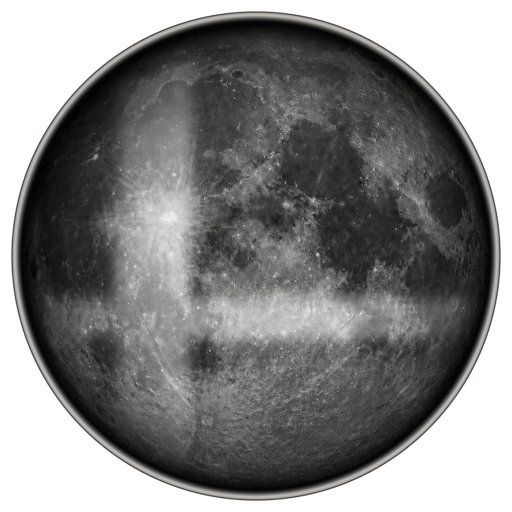

<div align="center">



# Lunar Clipper

**Search millions of Slippi replays. Turn the best moments into video.**

A desktop app that imports your [Slippi](https://slippi.gg/) replay collection (Super Smash Bros. Melee),
lets you hunt through it for exactly the moments you care about — a specific combo, a
zero-to-death, an edgeguard — and renders them out as high-quality clips. It is also built
into the [Lunar Database](https://lunarmelee.com): search every public game there, download
what you want straight into the app, and clip it.

[](https://github.com/madenney/lm-clipper/releases)
[](https://github.com/madenney/lm-clipper/releases)
[](LICENSE)
[](https://discord.gg/ThjMCW3F4R)
[](https://www.youtube.com/@lunar_melee)

[**Website**](https://lunarmelee.com) · [**Download**](https://github.com/madenney/lm-clipper/releases) · [**Discord**](https://discord.gg/ThjMCW3F4R) · [**YouTube**](https://www.youtube.com/@lunar_melee)

</div>

---

## What it does

Point it at a folder of `.slp` files — a few hundred, or a few million — and build a
**filter chain** to narrow them down. Each filter feeds the next, so you can go from
"every replay I own" to "every Falcon knee that killed off the top on Battlefield"
and export the result as video.

- **Download games** from the Lunar Database (millions of public replays): search by player,
  character, stage or tournament; downloads come straight from storage, resume if they stop,
  and are kept compressed
- **Pre-parsed moments**: search the combos and edgeguards Lunar has already found in every
  game, and download only the games you need
- **Import** `.slp` / `.slpz` replays in bulk, or drag a whole folder in
- **Filter** by game metadata — characters, stages, players, connect codes, dates
- **Find combos** with a combo parser: character-specific sequences (Falcon stomp → knee,
  Fox upthrow → upair), minimum hits, damage, kill confirms
- **Find edgeguards** with a dedicated parser that reconstructs the whole sequence —
  the launching hit, the recovery attempts, the denial — and scores how good it was
- **Search frame data** directly: action states, positions, stage zones
- **Write your own filter** in JavaScript if the built-ins don't cover it
- **Render video** via Slippi Dolphin's frame-by-frame dump + ffmpeg, at whatever
  resolution your hardware can take, with multiple Dolphin instances in parallel

It's backed by SQLite, so filtering stays fast across very large collections
(the Lunar Database it can search holds about 3.4 million games).

## Download

Grab the latest build from the [**Releases**](https://github.com/madenney/lm-clipper/releases) page
(or from the Software page on [lunarmelee.com](https://lunarmelee.com)).

| Platform | File |
| --- | --- |
| Windows 10/11 (64-bit) | `Lunar-Clipper-Setup-<version>.exe` |
| Linux, Ubuntu / Debian | `Lunar-Clipper-<version>.deb` (recommended: a real sandbox, installs from the Software centre) |
| Linux, other | `Lunar-Clipper-<version>.AppImage` (needs `libfuse2`: `sudo apt install libfuse2` on Ubuntu 22.04 and newer) |

macOS builds are not produced yet. Every release lists `SHA256SUMS.txt`: compare it with
`sha256sum` (Linux) or `Get-FileHash` (Windows PowerShell) if you want to check a download.

The app updates itself: once installed, new releases are downloaded and applied in place.
If you are on a 2.0.0 beta and the update banner does not show up, download the installer
and run it over the old one: your projects and settings are kept.

> **Windows will warn you the first time.** The installer is not code-signed yet, so
> SmartScreen shows "Windows protected your PC": click **More info, then Run anyway**. On
> Windows 11 with **Smart App Control** turned on, Windows may block unsigned installers
> outright; use the checksum above, or turn Smart App Control off for the install. Signing
> is planned ([RELEASING.md](RELEASING.md#code-signing)). Only Windows 11 with an NVIDIA GPU
> has been tested so far; Linux is experimental.

## Requirements

- The [Slippi Launcher](https://slippi.gg/downloads), which downloads the **Playback** build of
  Dolphin that Clipper records with (not the Netplay build you play online with). Clipper finds
  it by itself; if it does not, the setup wizard asks for it
- A Melee ISO (NTSC 1.02; a compressed .rvz or .gcz image works too)
- Windows: a recent NVIDIA GPU is the tested setup. Recording runs several Dolphin windows at
  once, so more CPU cores and RAM mean faster clips

Playing and recording need the Playback Dolphin and the ISO; searching, downloading and
filtering do not.

## Community

Lunar Clipper is built around a community of Melee players and content creators.

- 💬 **[Discord](https://discord.gg/ThjMCW3F4R)** — help, feature requests, and a `#videos`
  channel where people post what they've made with it
- 📺 **[YouTube](https://www.youtube.com/@lunar_melee)** — demos and clip compilations
  produced with the app
- 🌐 **[lunarmelee.com](https://lunarmelee.com)** — the project site, and a public archive
  of Slippi replays to search through

Bug reports and feature requests are welcome in
[Issues](https://github.com/madenney/lm-clipper/issues).

## Build from source

```bash
git clone https://github.com/madenney/lm-clipper.git
cd lm-clipper
npm ci          # Node 22.15 or newer
npm run start
```

Production build:

```bash
npm run build
```

Package an installer locally (without publishing). The helper programs are not in the
repository: fetch the pinned ffmpeg and build slpz (needs [Rust](https://rustup.rs)) for the
OS you are packaging on first:

```bash
npm run fetch:ffmpeg -- linux     # or: win
npm run build:slpz -- linux       # or: win
npx electron-builder --linux --publish never
```

Distribution builds are produced by GitHub Actions when a `v*` tag is pushed.
See [RELEASING.md](RELEASING.md) for the release + auto-update process, and
[CONTRIBUTING.md](CONTRIBUTING.md) for development setup and coding standards.

## Contributing

Contributions are welcome — see [CONTRIBUTING.md](CONTRIBUTING.md).

## Acknowledgments

- [slp-to-video](https://github.com/kevinsung/slp-to-video) — the foundation for Slippi replay → video conversion
- [slippi-js](https://github.com/project-slippi/slippi-js) — replay parsing
- [libmelee](https://github.com/altf4/libmelee) — stage geometry constants used by the edgeguard parser
- [electron-react-boilerplate](https://github.com/electron-react-boilerplate/electron-react-boilerplate) — project template
- [Slippi](https://slippi.gg/) — replay recording and Dolphin integration for Melee
- [ffmpeg](https://ffmpeg.org/), [slpz](https://crates.io/crates/slpz), the Melee HD texture
  pack team and the other bundled components, with their licences:
  [THIRD_PARTY_NOTICES.md](THIRD_PARTY_NOTICES.md) and [assets/PROVENANCE.md](assets/PROVENANCE.md)

## License

GNU General Public License v3.0 — see [LICENSE](LICENSE).
